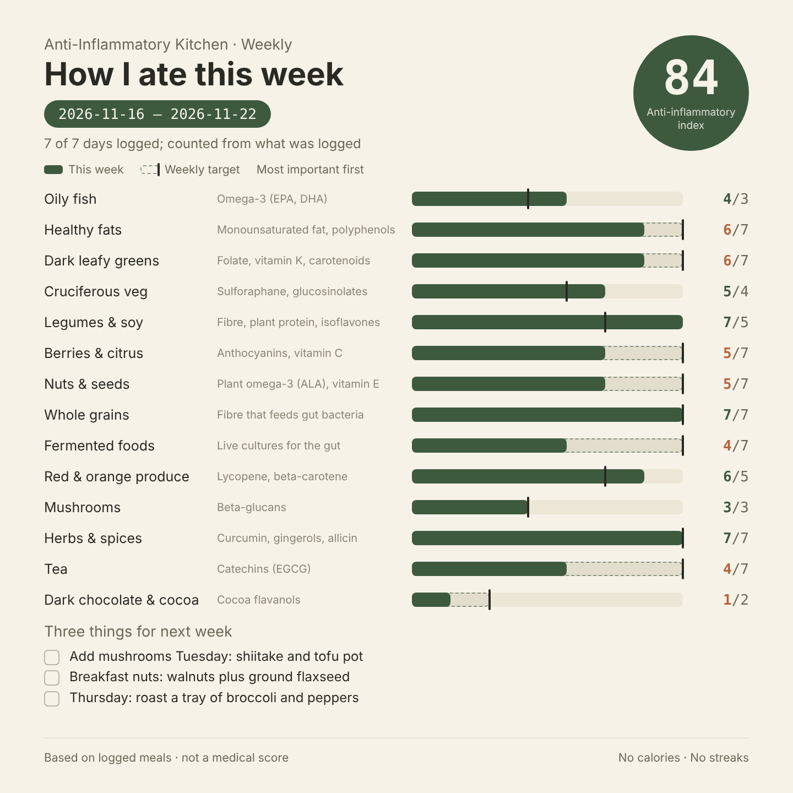
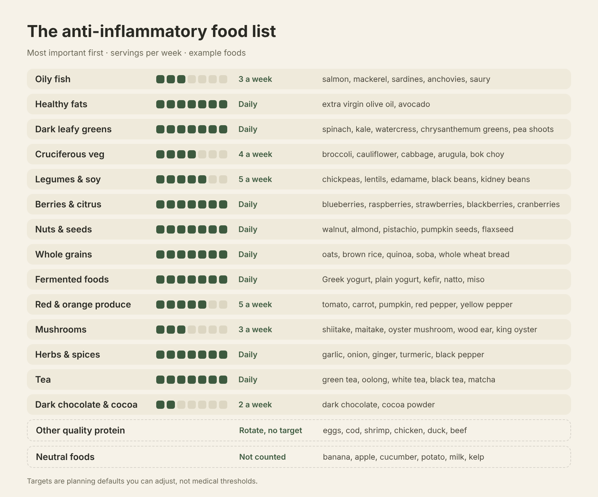

# Anti-Inflammatory Kitchen

**English** · [简体中文](README.zh-CN.md)

 

**An AI kitchen assistant for anti-inflammatory eating, built around what's already in your fridge.**

Tell it once what's in your kitchen. From then on it suggests meals from what you have, shows how to cook them, tells you what to buy, and reviews your week. No calorie counting, no streaks, no guilt.

**[Get started](#get-started)** · [Plugin](downloads/anti-inflammatory-kitchen-plugin.zip) · [Claude Skill ZIP](downloads/kitchen.zip) · [Chat guide](downloads/kitchen-chat-guide.md)

## What it does

| | Ask | You get |
|---|---|---|
| **Your fridge** | "Bought salmon, spinach and blueberries" · "The olive oil's finished" · or send a photo of groceries or a receipt | Your stock sorted into 19 food groups, updated as you buy and use things |
| **What to eat** | "What's for dinner?" · "Give me 3 breakfast options" · "I'm at a hawker centre, what should I order?" | Meals built from what's at home, at a restaurant, or from your own cookbooks |
| **How to cook it** | "How do I make that?" · "My spinach is about to go off, what can I cook?" · "Save this as my Wednesday fish soup" | Step-by-step recipes with timing and heat cues, clear-out meals for things about to spoil, and your favorites saved by name |
| **What to buy** | "What should I buy this week?" | What's already at home to use first, then up to three things worth buying |
| **Weekly review** | "How did I eat this week?" | An anti-inflammatory index, your gaps and three actions for next week, as a shareable image |
| **Meal prep** | "I want to prep once for the week" | Three bases in 90 minutes, 10-minute meals on weekdays |

Everything follows your settings: tell it your allergies, foods you avoid, goals like more plant protein, or how often you want each food group, and it plans around them. Works fully in English or Chinese. Planned meals never count as eaten, and a shopping cart never counts as stock.

## Get started

| Your AI tool | How |
|---|---|
| Claude (with custom Skills) | Upload [kitchen.zip](downloads/kitchen.zip) and turn it on · [steps](docs/installation.en.md#claude-upload) |
| Claude Code · Codex · Cursor · Gemini CLI | Install the plugin or the skill folder · [steps](docs/installation.en.md) |
| ChatGPT, Gemini, Kimi, DeepSeek and other chats | Upload the [chat guide](downloads/kitchen-chat-guide.md) to a project or chat · [steps](docs/installation.en.md#chat-import) |
| Any other Agent Skills tool | Import the `kitchen/` folder · [steps](docs/installation.en.md#agent-skills) |

1. Install it, then create a project called "Anti-Inflammatory Kitchen" and turn on memory if your tool has it.
2. Optional: tell it your allergies, restrictions and goals.
3. Tell it what's in your kitchen (type, talk or send photos), then ask "What's for breakfast?"

## Your data

Your stock, meal log, recipes and settings stay in your own project or workspace. The download contains no one's personal data; never commit yours to a public repo. Different AI tools don't sync with each other. [How state is saved](kitchen/references/state-files.md)

## Contribute

No API key needed. Local helpers need Python 3.10+ (standard library only). The skill's instructions are in Chinese; read the [English translation](kitchen/SKILL.en.md).

[Examples and structure](docs/development.en.md) · [Contributing](CONTRIBUTING.md) · [Changelog](CHANGELOG.md) · [MIT License](LICENSE) · [Open an issue](https://github.com/ma-xinxinxinxin/anti-inflammatory-kitchen/issues/new) (use fictional examples, no personal health data)

## Appendix: the full food list

Every food the skill recognizes, by group. Targets are a starting point; change any of them. Details: [nutrition plan](kitchen/references/nutrition-plan.md) · [food table](kitchen/references/food-table.md). The overall pattern follows the [AHA dietary guidance](https://professional.heart.org/en/science-news/2021-dietary-guidance-to-improve-cardiovascular-health/top-things-to-know); the frequencies here are this project's planning defaults, not clinically validated.

---

For everyday meal planning only. It does not diagnose conditions, interpret lab results, or advise on medication or supplement doses.
