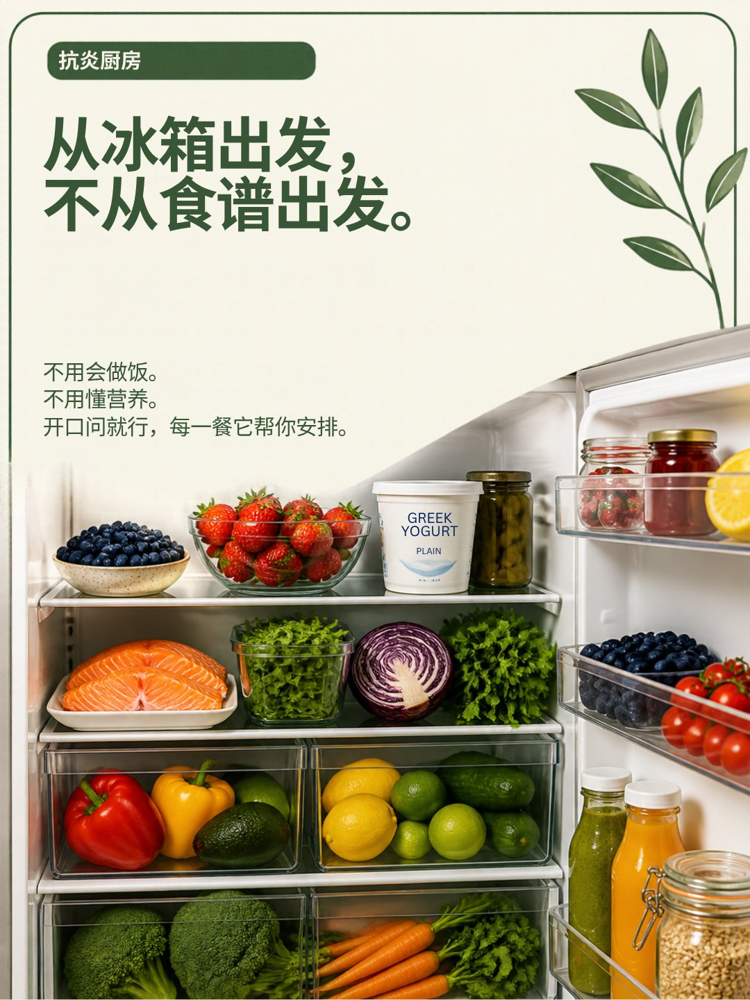
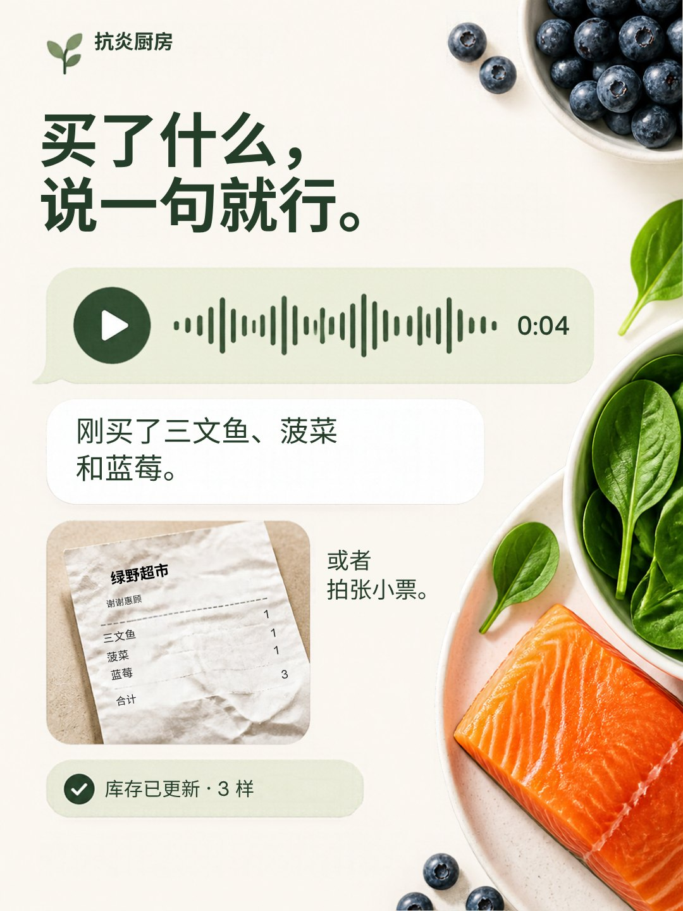
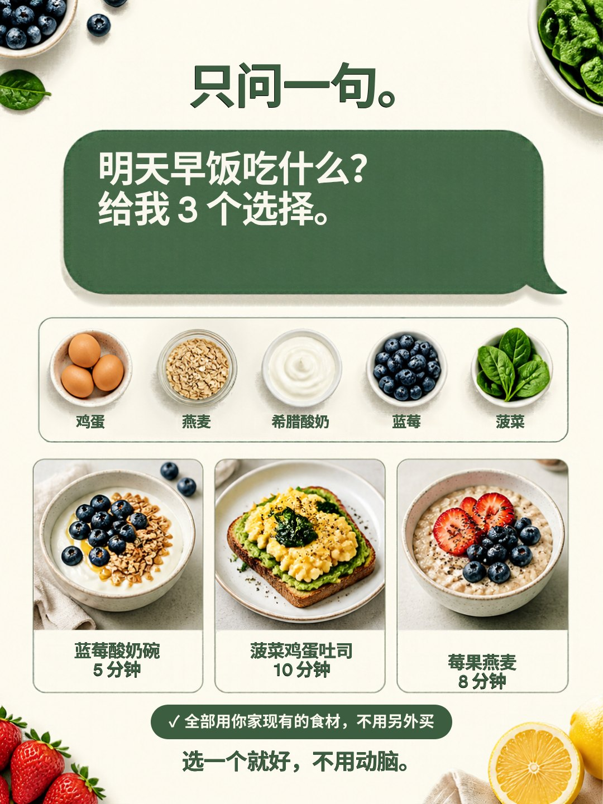
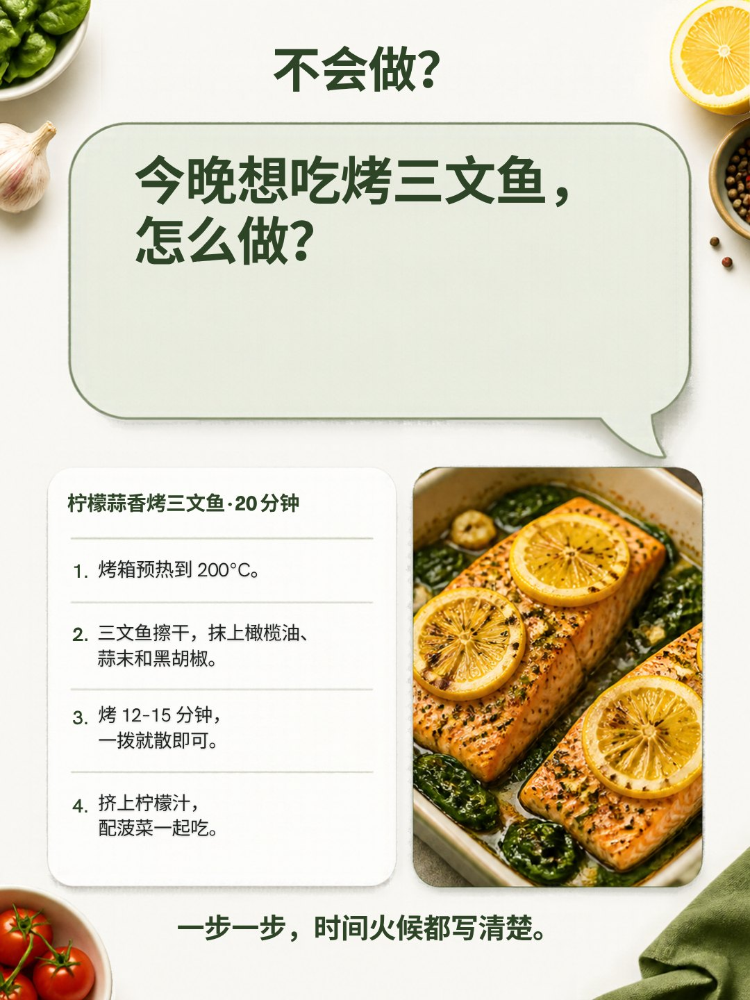
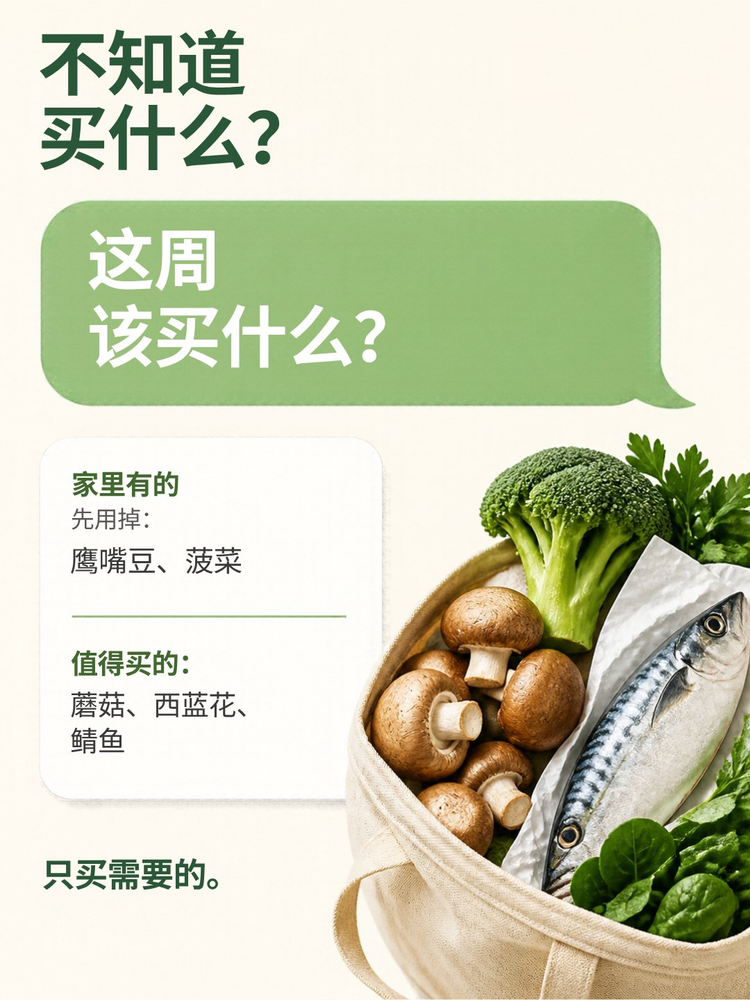
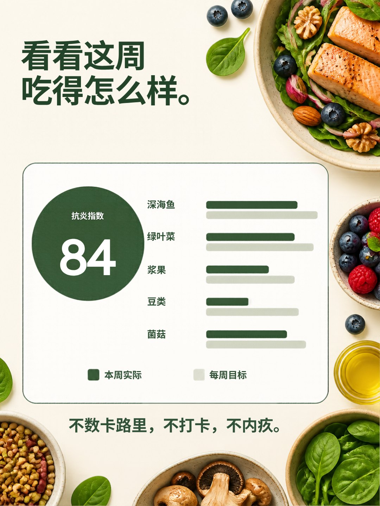
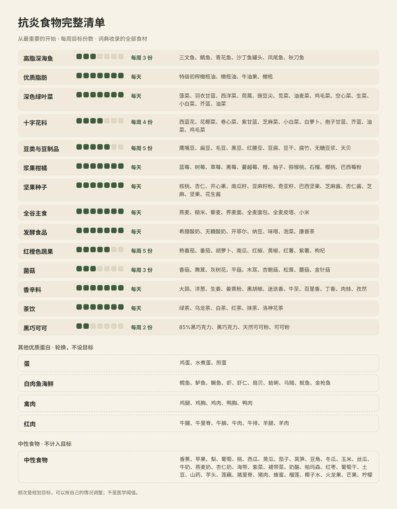

# 抗炎厨房 · Anti-Inflammatory Kitchen

[English](README.md) · **简体中文**

 

**围绕你冰箱里现有食材的抗炎饮食 AI 助手。**

告诉它一次厨房里有什么，之后它会用现有食材给你配餐、教你怎么做、告诉你该买什么，每周帮你复盘。不数卡路里，不打卡，不让你内疚。

**[开始使用](#开始使用)** · [插件包](downloads/anti-inflammatory-kitchen-plugin.zip) · [Claude Skill ZIP](downloads/kitchen.zip) · [对话导入指南](downloads/kitchen-chat-guide.md)

## 它能做什么

<table>
<tr>
<td width="50%"></td>
<td width="50%"></td>
</tr>
<tr>
<td width="50%"></td>
<td width="50%"></td>
</tr>
<tr>
<td width="50%"></td>
<td width="50%"></td>
</tr>
</table>

| | 你可以这样问 | 你会得到 |
|---|---|---|
| **冰箱库存** | 「买了三文鱼、菠菜和蓝莓」·「橄榄油用完了」· 或拍一张买的菜、购物小票 | 按 19 类整理好的库存，买了、用完随口更新 |
| **吃什么** | 「今晚吃什么？」·「给我 3 个早餐选项」·「在小贩中心，点什么？」 | 只用家里现有的食材配好一餐，不用另外买；在外面吃、从自己的菜谱书里挑也可以 |
| **怎么做** | 「这道怎么做？」·「菠菜快坏了，做什么菜？」·「把这个存成我的周三鱼汤」 | 带时间和火候的分步做法；围绕快坏的食材出清库菜；常做的菜按名字保存，下次直接叫出来 |
| **买什么** | 「这周该买什么？」 | 先列家里已有、该先用掉的，再给最多三样值得补买的 |
| **周复盘** | 「这周吃得怎么样？」 | 抗炎指数、缺口和下周三件事，可以生成分享图 |
| **备菜** | 「周末想一次备好一周的」 | 90 分钟做三个基底，工作日每顿 10 分钟 |

所有建议都按你的个人设置来：告诉它你的过敏、忌口、营养目标（比如多吃植物蛋白），或者每类食物想吃几次，它会记下并据此安排。中英文都能完整使用。计划的饭不会算成吃过，购物车也不会算成库存。

## 开始使用

| 你的 AI 工具 | 怎么装 |
|---|---|
| Claude（支持自定义 Skills） | 上传 [kitchen.zip](downloads/kitchen.zip) 并启用 · [步骤](docs/installation.md#claude-upload) |
| Claude Code · Codex · Cursor · Gemini CLI | 安装插件或 skill 文件夹 · [步骤](docs/installation.md) |
| ChatGPT、Gemini、Kimi、DeepSeek 等聊天工具 | 把[对话导入指南](downloads/kitchen-chat-guide.md)上传到项目或聊天 · [步骤](docs/installation.md#chat-import) |
| 其他支持 Agent Skills 的工具 | 导入 `kitchen/` 文件夹 · [步骤](docs/installation.md#agent-skills) |

1. 安装后新建一个「抗炎厨房」Project，工具支持的话打开记忆功能。
2. 可选：告诉它你的过敏、忌口和目标。
3. 告诉它厨房里有什么（打字、说话或拍照都行），然后问「今天早餐吃什么？」

## 数据存在哪

库存、饮食记录、菜谱和个人设置都保存在你自己的项目或工作区里。下载包里没有任何人的私人数据；你的记录不要提交到公开仓库。不同 AI 工具之间不会自动同步。[存储规则](kitchen/references/state-files.md)

## 参与改进

不需要 API key；本地脚本需要 Python 3.10+，只用标准库。

[运行示例与项目结构](docs/development.md) · [贡献指南](CONTRIBUTING.md) · [更新记录](CHANGELOG.md) · [MIT License](LICENSE) · [提交反馈](https://github.com/ma-xinxinxinxin/anti-inflammatory-kitchen/issues/new)（请用虚构示例，不要上传健康资料）

作者的话

我的生活现在每一天都离不开它。

## 附录：抗炎食物完整清单

这是 skill 能识别的全部食材，按类别列出。频次是起点，每一项都可以改。详细规则见[抗炎营养规划](kitchen/references/nutrition-plan.md) · [食材表](kitchen/references/food-table.md)。整体饮食模式参考 [AHA 膳食指导](https://professional.heart.org/en/science-news/2021-dietary-guidance-to-improve-cardiovascular-health/top-things-to-know)；这里的频次是本项目的规划默认值，未经临床验证。

---

仅用于日常饮食搭配，不提供疾病诊断、化验解读或药物、补剂剂量建议。
